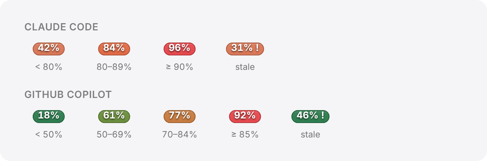

# SwiftBar Usage Indicators

[](https://github.com/FabianIMV/swiftbar-usage-indicators/actions/workflows/ci.yml)


[](LICENSE)

Menu bar pills for macOS that show your **Claude Code** and **GitHub Copilot** usage at a
glance. Built as [SwiftBar](https://swiftbar.github.io/) plugins, with each pill rendered as a
native image.

<p align="center">
  
</p>

## Features

- **Two pills**: Claude Code usage (orange) and Copilot premium interactions (green).
- **Color ramps**: each pill shifts toward red as you approach the limit.
- **Dropdown details**: progress bar, used vs. total, remaining, reset time and last update.
- **Stale marker**: a trailing `!` whenever fresh data could not be fetched.
- **Lightweight**: Python standard library only, aggressive caching, rate-limit aware.
- **Private**: tokens are read from local credentials, held in memory and never written to disk or logged.

| Claude Code | GitHub Copilot |
| :---: | :---: |
|  |  |

## Requirements

- macOS with [SwiftBar](https://swiftbar.github.io/) (`brew install --cask swiftbar`)
- Xcode Command Line Tools, to build the renderer (`xcode-select --install`)
- Python 3.9+
- **Claude Code**: signed in on this machine (credentials file or macOS Keychain)
- **GitHub Copilot**: [GitHub CLI](https://cli.github.com/) signed in (`gh auth login`)

## Installation

```bash
git clone https://github.com/FabianIMV/swiftbar-usage-indicators.git
cd swiftbar-usage-indicators
./install.sh
```

The script:

1. Builds `pill_render` from `indicators/pill_render.swift`.
2. Copies the runtime (fetchers and renderer) to `~/indicators`.
3. Copies the plugins to SwiftBar's plugin folder (read from SwiftBar's settings, or set
   `SWIFTBAR_PLUGIN_DIR`).
4. Restarts SwiftBar.

To remove everything, including the caches:

```bash
./install.sh --uninstall
```

<details>
<summary>Manual installation</summary>

```bash
swiftc -O indicators/pill_render.swift -o indicators/pill_render

mkdir -p ~/indicators
cp -R indicators/. ~/indicators/

PLUGINS="$HOME/Library/Application Support/SwiftBar/Plugins"
mkdir -p "$PLUGINS"
cp plugins/*.py "$PLUGINS/"
chmod +x "$PLUGINS"/*.py ~/indicators/pill_render

pkill SwiftBar; open -a SwiftBar
```

The plugins expect the runtime at `~/indicators`. To use another location, edit the
`sys.path.insert(...)` and `PILL_RENDER` lines at the top of each plugin.

</details>

## How it works

```
SwiftBar (every 10s)
 └─ plugins/N-name.10s.py
     ├─ fetcher.get_usage()  ──►  ~/.cache/*-usage.json
     └─ pill_render "78%" "#D97757"  ──►  base64 PNG  ──►  menu bar
```

Each plugin runs every 10 seconds and always exits with code `0`, so SwiftBar never hides it.

### Claude Code

`indicators/claude-usage/fetcher.py` queries the OAuth usage endpoint that backs Claude
Code's `/usage` command. It looks for a token in this order:

1. `~/.claude/.credentials.json`, if the access token has not expired.
2. The macOS Keychain item `Claude Code-credentials`, refreshing it through OAuth when it
   has expired.
3. `CLAUDE_CODE_OAUTH_TOKEN` from running `claude` processes.

Network calls are throttled to one every 120 seconds, with a backoff after HTTP 429. If no
token works, it falls back to a rolling 5-hour estimate built from local transcripts in
`~/.claude/projects`, always marked as stale.

### GitHub Copilot

`indicators/copilot-indicator/fetcher.py` gets a token with `gh auth token`, calls
`api.github.com/copilot_internal/user` and reads the `premium_interactions` quota. The
plugin only refreshes when the cache is older than 30 seconds.

### Rendering

`indicators/pill_render` (Swift + AppKit) draws a rounded pill with SF bold white text, a
subtle gradient and a 1px border, then prints it as a base64 PNG that SwiftBar embeds in
the menu bar. If the renderer is missing or fails, the plugins fall back to ANSI-colored
text.

```bash
pill_render <text> <base-hex> [top-hex] [height-pt]
```

## Configuration

| Variable | Default | Description |
| --- | --- | --- |
| `CLAUDE_USAGE_MIN_INTERVAL` | `120` | Minimum seconds between Claude API calls. |
| `CLAUDE_USAGE_BACKOFF_INTERVAL` | `300` | Seconds to wait after a 429 or other API error. |
| `CLAUDE_USAGE_5H_BUDGET_TOKENS` | `88000000` | Token budget for the offline 5-hour estimate. |

SwiftBar plugins do not inherit your shell environment. Set these with `launchctl setenv`
or edit the defaults at the top of the fetcher.

The refresh rate comes from the plugin filename (`*.10s.py`); rename the file to change it.

## Colors

<p align="center">
  
</p>

| Service | Bands |
| --- | --- |
| Claude Code | `< 80%` `#D97757` · `80–89%` `#E06A45` · `≥ 90%` `#E5484D` |
| GitHub Copilot | `< 50%` `#2E7D4F` · `50–69%` `#6B8E3D` · `70–84%` `#C77B3F` · `≥ 85%` `#E5484D` |

## Cache files

| File | Contents |
| --- | --- |
| `~/.cache/claude-usage.json` | Last Claude Code usage snapshot |
| `~/.cache/claude-usage.next` | Backoff deadline after a rate limit |
| `~/.cache/copilot-usage.json` | Last Copilot usage snapshot |

Both snapshots share the same schema: `percent_used`, `used`, `entitlement`, `remaining`,
`reset`, `updated_at` and `stale`.

## Troubleshooting

- **Pill shows `!`**: the last refresh failed and the data is cached. Run the fetcher by hand
  to see why: `python3 ~/indicators/claude-usage/fetcher.py`.
- **"Copilot: no data"**: check that `gh auth token` works from a login shell.
- **Plain colored text instead of a pill**: `~/indicators/pill_render` is missing or not
  executable. Re-run `./install.sh`.

## Development

The README images are generated with [Playwright](https://playwright.dev/) from a static
mock of the menu bar in `docs/demo/index.html`:

```bash
npm install --no-save playwright
npx playwright install chromium
node scripts/screenshots.mjs
```

## Disclaimer

Both data sources are internal, undocumented endpoints and may change without notice. This
project is not affiliated with Anthropic or GitHub.

## License

[MIT](LICENSE)
